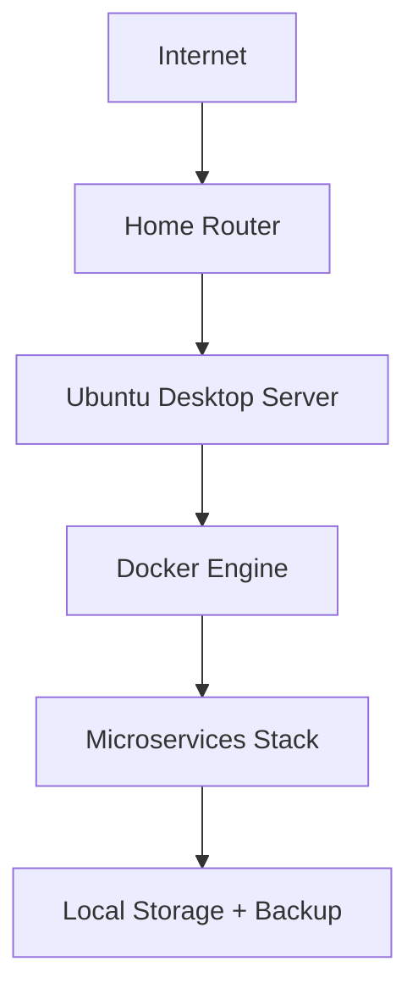

# Seasonality SaaS - Enhanced Prompt Engineering Guide
## Complete Build From Scratch with Concrete Examples & Error Handling

## 📋 Project Overview & Context

**Mission**: Build a modern, scalable Seasonality Trading Analysis SaaS from scratch
**Source**: `old-software/` Python Dash application (reference only)
**Target**: Cloud-native microservices architecture with modern tech stack
**Infrastructure**: Ubuntu Desktop server (old PC) for initial deployment
**Approach**: AI-assisted development with role-based prompting and concrete examples

### 🏗️ Architecture Vision
- **Frontend**: Next.js 14+ with TypeScript (AI Studio assisted)
- **Backend**: Node.js microservices with Express/Fastify
- **Database**: PostgreSQL with Prisma ORM + Redis caching
- **Infrastructure**: Docker containers on Ubuntu Desktop server
- **Data Pipeline**: Admin panel upload → Processing → Analysis
- **Authentication**: JWT + OAuth2 with role-based access
- **Monitoring**: Prometheus + Grafana + ELK stack

---

## 🔗 PROMPT CHAINING WORKFLOW

### Context Passing Template
```markdown
PREVIOUS CONTEXT FROM PROMPT X.Y:
[Paste relevant output here - architecture docs, schemas, etc.]

DEPENDENCIES COMPLETED:
- [List completed prompts and their key outputs]

NOW FOR PROMPT X.Z:
[New prompt building on previous context]

CONTEXT BUDGET: ~2000 tokens for previous context + 4000 for new prompt
```

### Chaining Sequence
1. **PROMPT 1.1** → Architecture Document → **PROMPT 1.2**
2. **PROMPT 1.2** → Database Schema → **PROMPT 2.1, 2.2, 2.3**
3. **PROMPT 2.x** → Backend Services → **PROMPT 3.1, 3.2**
4. **PROMPT 3.x** → Frontend Foundation → **PROMPT 4.1, 4.2**
5. **PROMPT 4.x** → Infrastructure → **PROMPT 5.1, 5.2**

---

## ⚠️ COMMON PITFALLS & SOLUTIONS

### Pitfall 1: Token Limit Exceeded
**Problem**: Prompt + codebase context exceeds model limits
**Solution**: Use prompt compression techniques, focus on specific files
```markdown
CONTEXT COMPRESSION TEMPLATE:
Instead of: [Full file content - 3000 tokens]
Use: [Key interfaces and functions - 500 tokens]
```

### Pitfall 2: Inconsistent Responses
**Problem**: AI generates different code structure each time
**Solution**: Include strict TypeScript interfaces in prompt
```typescript
// REQUIRED INTERFACE - DO NOT DEVIATE
interface AnalysisResult {
  readonly id: string
  readonly type: AnalysisType
  readonly data: AnalysisData
  readonly metadata: AnalysisMetadata
}
```

### Pitfall 3: Security Vulnerabilities
**Problem**: AI-generated code has SQL injection risks
**Solution**: Always include security checklist in prompts
```markdown
SECURITY CHECKLIST (MANDATORY):
- [ ] Input validation with Zod/Joi
- [ ] Parameterized queries only
- [ ] Rate limiting implemented
- [ ] Authentication middleware applied
- [ ] CORS properly configured
```

---

## 📁 PHASE 1: FOUNDATION & ARCHITECTURE

### 🔧 PROMPT 1.1: System Architecture Design (Enhanced)

**Role**: Senior Software Architect + Infrastructure Engineer
**Technique**: Chain of Thought + Few-Shot Examples
**Target**: Claude 3.5 Sonnet / GPT-4
**Token Budget**: ~6000 tokens
**Output**: Architecture documentation and diagrams

```
ROLE: You are a Senior Software Architect with 15+ years experience in building scalable SaaS platforms, microservices architecture, and financial technology systems.

INFRASTRUCTURE CONTEXT:
- Deployment Target: Ubuntu Desktop (old PC repurposed as server)
- Network: Home/office network with port forwarding
- Resources: Limited but sufficient for initial deployment
- Scaling Strategy: Start simple, design for cloud migration later

CONTEXT ANALYSIS:
- Source: Python Dash application in `old-software/` directory
- Business: Seasonality trading analysis for financial markets
- Users: Traders, analysts, research teams, administrators
- Scale: Multi-tenant SaaS supporting 100+ concurrent users initially
- Data: Time-series financial data with complex analysis requirements

FEW-SHOT EXAMPLES:

### EXAMPLE 1: Microservice Decomposition
**Input**: Monolithic Python Dash app with multiple analysis tabs
**Expected Output**:
```yaml
services:
  api-gateway:
    responsibility: "Request routing, authentication, rate limiting"
    endpoints: ["/api/v1/*"]
    dependencies: ["auth-service"]
  
  auth-service:
    responsibility: "User authentication, JWT management, RBAC"
    endpoints: ["/auth/login", "/auth/register", "/auth/verify"]
    dependencies: ["postgres"]
  
  data-service:
    responsibility: "CSV upload, validation, multi-timeframe generation"
    endpoints: ["/data/upload", "/data/process", "/data/validate"]
    dependencies: ["postgres", "redis", "rabbitmq"]
```

### EXAMPLE 2: Ubuntu Server Architecture
**Input**: Limited hardware resources, home network deployment
**Expected Output**:
```yaml
ubuntu_server_setup:
  hardware_optimization:
    - "Docker resource limits per service"
    - "Nginx reverse proxy for SSL termination"
    - "Local storage with backup strategy"
  
  network_configuration:
    - "Port forwarding: 80, 443, 22"
    - "UFW firewall with specific rules"
    - "Dynamic DNS for external access"
  
  monitoring_stack:
    - "Lightweight Prometheus setup"
    - "Grafana with essential dashboards"
    - "Log rotation and cleanup"
```

CHAIN OF THOUGHT ARCHITECTURE DESIGN:

STEP 1: UBUNTU SERVER CONSTRAINTS ANALYSIS
Analyze deployment constraints:
- Hardware limitations (RAM, CPU, storage)
- Network configuration requirements
- Security considerations for home deployment
- Backup and disaster recovery options

STEP 2: MICROSERVICES DECOMPOSITION FOR LIMITED RESOURCES
Design service boundaries considering:
- Memory footprint per service
- CPU usage patterns
- Database connection pooling
- Shared vs dedicated resources

STEP 3: SCALABILITY PATH DESIGN
Plan evolution strategy:
- Phase 1: Single server deployment
- Phase 2: Container orchestration
- Phase 3: Cloud migration readiness
- Phase 4: Multi-region deployment

STEP 4: UBUNTU-SPECIFIC INFRASTRUCTURE
Design Ubuntu server setup:
- Docker Compose for service orchestration
- Nginx for reverse proxy and SSL
- Systemd for service management
- Cron jobs for maintenance tasks

DELIVERABLES REQUIRED:

1. **Ubuntu Server Architecture Diagram**


2. **Resource Allocation Plan**
```yaml
resource_allocation:
  total_ram: "16GB"  # Adjust based on actual hardware
  per_service_limits:
    frontend: "512MB"
    api-gateway: "256MB"
    auth-service: "256MB"
    data-service: "1GB"
    analysis-service: "2GB"
    postgres: "2GB"
    redis: "256MB"
```

3. **Docker Compose Configuration**
```yaml
version: '3.8'
services:
  nginx:
    image: nginx:alpine
    ports: ["80:80", "443:443"]
    volumes: ["./nginx.conf:/etc/nginx/nginx.conf"]
  
  postgres:
    image: postgres:15-alpine
    environment:
      POSTGRES_DB: seasonality
    volumes: ["postgres_data:/var/lib/postgresql/data"]
```

4. **Security Configuration**
```bash
# UFW Firewall Rules
ufw allow 22/tcp    # SSH
ufw allow 80/tcp    # HTTP
ufw allow 443/tcp   # HTTPS
ufw deny incoming
ufw allow outgoing
```

SUCCESS CRITERIA:
- Architecture supports 100+ concurrent users on Ubuntu server
- Resource usage <80% of available hardware
- Deployment time <30 minutes from fresh Ubuntu install
- Backup and recovery procedures documented
- Security hardening for home network deployment
```

### 🔧 PROMPT 1.2: Database Schema Design (Enhanced)

**Role**: Senior Database Architect + Data Engineer
**Technique**: Domain-Driven Design + Concrete Examples
**Target**: Claude 3.5 Sonnet
**Token Budget**: ~5000 tokens
**Output**: Complete Prisma schema with migration scripts

```
ROLE: You are a Senior Database Architect specializing in financial data systems, time-series databases, and high-performance query optimization.

PREVIOUS CONTEXT FROM PROMPT 1.1:
[Architecture document with microservices design and Ubuntu server constraints]

FEW-SHOT EXAMPLES:

### EXAMPLE 1: Multi-Timeframe Data Structure
**Input**: Python CSV files (1_Daily.csv, 2_MondayWeekly.csv, etc.)
**Expected Output**:
```prisma
model DailyData {
  id        Int      @id @default(autoincrement())
  date      DateTime @db.Date
  tickerId  Int
  open      Float
  high      Float
  low       Float
  close     Float
  volume    Float
  
  // Calculated fields
  returnPercentage Float?
  
  // Relationships
  ticker    Ticker   @relation(fields: [tickerId], references: [id])
  
  @@unique([date, tickerId])
  @@index([date])
  @@index([tickerId, date])
}
```

### EXAMPLE 2: Multi-Tenant Schema Pattern
**Input**: SaaS requirement with tenant isolation
**Expected Output**:
```prisma
model Tenant {
  id        String   @id @default(cuid())
  name      String
  domain    String   @unique
  isActive  Boolean  @default(true)
  createdAt DateTime @default(now())
  
  // Relationships
  users     User[]
  tickers   Ticker[]
  
  @@map("tenants")
}

// All data tables include tenantId for isolation
model Ticker {
  id       Int    @id @default(autoincrement())
  symbol   String
  tenantId String
  
  tenant   Tenant @relation(fields: [tenantId], references: [id])
  
  @@unique([symbol, tenantId])
  @@index([tenantId])
}
```

### EXAMPLE 3: Performance Optimization
**Input**: Large dataset queries need optimization
**Expected Output**:
```prisma
model SeasonalityData {
  // Partitioning strategy for time-series data
  @@map("seasonality_data")
  
  // Composite indexes for common query patterns
  @@index([tenantId, tickerId, date])
  @@index([tenantId, date]) // For cross-ticker analysis
  @@index([tickerId, date(sort: Desc)]) // For latest data queries
}
```

UBUNTU SERVER DATABASE OPTIMIZATION:

STEP 1: RESOURCE-CONSTRAINED DESIGN
Design for limited Ubuntu server resources:
- Efficient indexing strategy
- Partitioning for large tables
- Connection pooling configuration
- Memory usage optimization

STEP 2: BACKUP STRATEGY FOR HOME SERVER
```sql
-- Automated backup script for Ubuntu server
CREATE OR REPLACE FUNCTION create_daily_backup()
RETURNS void AS $$
BEGIN
  PERFORM pg_dump('seasonality') TO '/backup/seasonality_' || CURRENT_DATE || '.sql';
END;
$$ LANGUAGE plpgsql;
```

REQUIRED SCHEMAS:

1. **Multi-Tenant Foundation**
```prisma
generator client {
  provider = "prisma-client-js"
}

datasource db {
  provider = "postgresql"
  url      = env("DATABASE_URL")
}

// Tenant management
model Tenant {
  id          String   @id @default(cuid())
  name        String
  domain      String   @unique
  isActive    Boolean  @default(true)
  maxUsers    Int      @default(10)
  maxStorage  BigInt   @default(1073741824) // 1GB in bytes
  createdAt   DateTime @default(now())
  updatedAt   DateTime @updatedAt
  
  // Relationships
  users       User[]
  tickers     Ticker[]
  uploadBatch UploadBatch[]
  
  @@map("tenants")
}
```

2. **User Management with RBAC**
```prisma
enum UserRole {
  SUPER_ADMIN
  TENANT_ADMIN
  RESEARCH_TEAM
  ANALYST
  VIEWER
}

model User {
  id          String    @id @default(cuid())
  email       String    @unique
  name        String
  password    String    // bcrypt hashed
  role        UserRole  @default(VIEWER)
  isActive    Boolean   @default(true)
  lastLogin   DateTime?
  tenantId    String
  createdAt   DateTime  @default(now())
  updatedAt   DateTime  @updatedAt
  
  // Relationships
  tenant      Tenant    @relation(fields: [tenantId], references: [id])
  sessions    Session[]
  auditLogs   AuditLog[]
  
  @@index([tenantId])
  @@index([email])
  @@map("users")
}
```

3. **Financial Data Schema**
```prisma
model Ticker {
  id          Int      @id @default(autoincrement())
  symbol      String
  name        String?
  exchange    String?
  sector      String?
  tenantId    String
  isActive    Boolean  @default(true)
  createdAt   DateTime @default(now())
  updatedAt   DateTime @updatedAt
  
  // Relationships
  tenant      Tenant   @relation(fields: [tenantId], references: [id])
  dailyData   DailyData[]
  weeklyData  WeeklyData[]
  monthlyData MonthlyData[]
  yearlyData  YearlyData[]
  
  @@unique([symbol, tenantId])
  @@index([tenantId])
  @@index([symbol])
  @@map("tickers")
}

model DailyData {
  id                    Int      @id @default(autoincrement())
  date                  DateTime @db.Date
  tickerId              Int
  tenantId              String   // Denormalized for performance
  
  // OHLCV Data
  open                  Float
  high                  Float
  low                   Float
  close                 Float
  volume                Float
  openInterest          Float?
  
  // Calculated Fields
  returnPercentage      Float?
  weekday               String?
  
  // Metadata
  createdAt             DateTime @default(now())
  updatedAt             DateTime @updatedAt
  
  // Relationships
  ticker                Ticker   @relation(fields: [tickerId], references: [id])
  
  @@unique([date, tickerId])
  @@index([tenantId, tickerId, date])
  @@index([tenantId, date])
  @@index([tickerId, date(sort: Desc)])
  @@map("daily_data")
}
```

UBUNTU SERVER CONFIGURATION:

1. **PostgreSQL Optimization for Limited Resources**
```sql
-- postgresql.conf optimizations for Ubuntu server
shared_buffers = 256MB          # 25% of available RAM
effective_cache_size = 1GB      # 75% of available RAM
work_mem = 4MB                  # Per connection
maintenance_work_mem = 64MB     # For maintenance operations
max_connections = 100           # Reasonable limit
```

2. **Connection Pooling Configuration**
```typescript
// Prisma connection pooling for Ubuntu server
const prisma = new PrismaClient({
  datasources: {
    db: {
      url: process.env.DATABASE_URL + "?connection_limit=20&pool_timeout=20"
    }
  }
})
```

DELIVERABLES:

1. **Complete Prisma Schema** (schema.prisma)
2. **Migration Scripts** with rollback procedures
3. **Ubuntu Server PostgreSQL Configuration**
4. **Backup and Recovery Scripts**
5. **Performance Monitoring Queries**
6. **Data Seeding Scripts** for development

PERFORMANCE TARGETS FOR UBUNTU SERVER:
- Query response time: <200ms for 95% of queries
- Data ingestion: 1,000+ records/second
- Concurrent connections: 50+ without degradation
- Storage efficiency: 60% compression ratio
- Backup time: <10 minutes for full backup
```
---

## 📁 PHASE 2: BACKEND MICROSERVICES DEVELOPMENT

### 🔧 PROMPT 2.1: API Gateway & Authentication Service (Enhanced)

**Role**: Senior Backend Developer + Security Engineer
**Technique**: Zero-Shot + Security-First Design + Concrete Examples
**Target**: Claude 3.5 Sonnet
**Token Budget**: ~5500 tokens
**Output**: API Gateway and Auth microservice

```
ROLE: You are a Senior Backend Developer with expertise in API Gateway design, OAuth2/JWT implementation, and enterprise security patterns.

PREVIOUS CONTEXT FROM PROMPT 1.2:
[Database schema with multi-tenant User model, Tenant model, and RBAC structure]

UBUNTU SERVER CONTEXT:
- Deployment: Docker containers on Ubuntu Desktop
- Network: Home network with port forwarding
- SSL: Let's Encrypt certificates via Nginx
- Resources: Limited memory, optimize for efficiency

FEW-SHOT EXAMPLES:

### EXAMPLE 1: JWT Authentication Flow
**Input**: User login request with email/password
**Expected Output**:
```typescript
// Authentication service response
interface AuthResponse {
  success: boolean
  user?: {
    id: string
    email: string
    name: string
    role: UserRole
    tenantId: string
  }
  tokens?: {
    accessToken: string    // 15 minutes expiry
    refreshToken: string   // 7 days expiry
  }
  error?: string
}

// Example implementation
async function authenticateUser(email: string, password: string): Promise<AuthResponse> {
  const user = await prisma.user.findUnique({
    where: { email },
    include: { tenant: true }
  })
  
  if (!user || !user.isActive || !user.tenant.isActive) {
    return { success: false, error: 'Invalid credentials' }
  }
  
  const isValidPassword = await bcrypt.compare(password, user.password)
  if (!isValidPassword) {
    return { success: false, error: 'Invalid credentials' }
  }
  
  const tokens = generateTokens(user)
  await createSession(user.id, tokens.refreshToken)
  
  return {
    success: true,
    user: {
      id: user.id,
      email: user.email,
      name: user.name,
      role: user.role,
      tenantId: user.tenantId
    },
    tokens
  }
}
```

### EXAMPLE 2: API Gateway Route Configuration
**Input**: Microservice routing requirements
**Expected Output**:
```typescript
// Route configuration for Ubuntu server deployment
const routes: RouteConfig[] = [
  {
    path: '/api/v1/auth/*',
    target: 'http://auth-service:3001',
    auth: false,
    rateLimit: { windowMs: 900000, max: 5 } // 5 requests per 15 minutes
  },
  {
    path: '/api/v1/data/*',
    target: 'http://data-service:3002',
    auth: true,
    roles: ['RESEARCH_TEAM', 'TENANT_ADMIN'],
    rateLimit: { windowMs: 60000, max: 100 } // 100 requests per minute
  },
  {
    path: '/api/v1/analysis/*',
    target: 'http://analysis-service:3003',
    auth: true,
    rateLimit: { windowMs: 60000, max: 50 } // 50 requests per minute
  }
]
```

### EXAMPLE 3: Ubuntu Server Security Configuration
**Input**: Home network deployment security requirements
**Expected Output**:
```typescript
// Security middleware for Ubuntu server
const securityConfig = {
  helmet: {
    contentSecurityPolicy: {
      directives: {
        defaultSrc: ["'self'"],
        styleSrc: ["'self'", "'unsafe-inline'"],
        scriptSrc: ["'self'"],
        imgSrc: ["'self'", "data:", "https:"]
      }
    },
    hsts: {
      maxAge: 31536000,
      includeSubDomains: true,
      preload: true
    }
  },
  cors: {
    origin: process.env.FRONTEND_URL || 'http://localhost:3000',
    credentials: true,
    optionsSuccessStatus: 200
  },
  rateLimit: {
    windowMs: 15 * 60 * 1000, // 15 minutes
    max: 100, // Limit each IP to 100 requests per windowMs
    message: 'Too many requests from this IP'
  }
}
```

UBUNTU SERVER OPTIMIZATION:

STEP 1: RESOURCE-EFFICIENT DESIGN
Design for Ubuntu server constraints:
- Minimal memory footprint per service
- Efficient connection pooling
- Optimized Docker images
- Health check endpoints

STEP 2: HOME NETWORK SECURITY
Implement security for home deployment:
- Fail2ban integration for brute force protection
- UFW firewall rules
- SSL certificate automation
- VPN access for administration

MICROSERVICE ARCHITECTURE:

SERVICE 1: API Gateway (Port 3000)
```typescript
// API Gateway main application
import express from 'express'
import helmet from 'helmet'
import cors from 'cors'
import rateLimit from 'express-rate-limit'
import { createProxyMiddleware } from 'http-proxy-middleware'

const app = express()

// Security middleware
app.use(helmet(securityConfig.helmet))
app.use(cors(securityConfig.cors))
app.use(rateLimit(securityConfig.rateLimit))

// Authentication middleware
app.use('/api/v1', authenticationMiddleware)

// Route proxying
routes.forEach(route => {
  app.use(route.path, createProxyMiddleware({
    target: route.target,
    changeOrigin: true,
    onError: (err, req, res) => {
      console.error(`Proxy error for ${route.path}:`, err)
      res.status(503).json({ error: 'Service temporarily unavailable' })
    }
  }))
})

// Health check
app.get('/health', (req, res) => {
  res.json({ 
    status: 'healthy', 
    timestamp: new Date().toISOString(),
    uptime: process.uptime()
  })
})

export default app
```

SERVICE 2: Authentication Service (Port 3001)
```typescript
// Authentication service with Ubuntu optimization
import express from 'express'
import bcrypt from 'bcrypt'
import jwt from 'jsonwebtoken'
import { PrismaClient } from '@prisma/client'
import rateLimit from 'express-rate-limit'

const app = express()
const prisma = new PrismaClient({
  datasources: {
    db: {
      url: process.env.DATABASE_URL + "?connection_limit=5" // Limited for Ubuntu server
    }
  }
})

// Rate limiting for auth endpoints
const authLimiter = rateLimit({
  windowMs: 15 * 60 * 1000, // 15 minutes
  max: 5, // 5 attempts per window
  skipSuccessfulRequests: true,
  message: { error: 'Too many authentication attempts' }
})

// Login endpoint
app.post('/login', authLimiter, async (req, res) => {
  try {
    const { email, password } = req.body
    
    // Input validation
    if (!email || !password) {
      return res.status(400).json({ error: 'Email and password required' })
    }
    
    const result = await authenticateUser(email, password)
    
    if (!result.success) {
      return res.status(401).json({ error: result.error })
    }
    
    res.json(result)
  } catch (error) {
    console.error('Login error:', error)
    res.status(500).json({ error: 'Internal server error' })
  }
})

// Token refresh endpoint
app.post('/refresh', async (req, res) => {
  try {
    const { refreshToken } = req.body
    
    if (!refreshToken) {
      return res.status(400).json({ error: 'Refresh token required' })
    }
    
    const result = await refreshTokens(refreshToken)
    res.json(result)
  } catch (error) {
    console.error('Token refresh error:', error)
    res.status(500).json({ error: 'Internal server error' })
  }
})

export default app
```

UBUNTU SERVER DEPLOYMENT:

1. **Docker Compose Configuration**
```yaml
version: '3.8'
services:
  api-gateway:
    build: ./services/api-gateway
    ports:
      - "3000:3000"
    environment:
      - NODE_ENV=production
      - JWT_SECRET=${JWT_SECRET}
    depends_on:
      - auth-service
    restart: unless-stopped
    mem_limit: 256m
    
  auth-service:
    build: ./services/auth-service
    environment:
      - NODE_ENV=production
      - DATABASE_URL=${DATABASE_URL}
      - JWT_SECRET=${JWT_SECRET}
    depends_on:
      - postgres
    restart: unless-stopped
    mem_limit: 256m
    
  postgres:
    image: postgres:15-alpine
    environment:
      - POSTGRES_DB=seasonality
      - POSTGRES_USER=${DB_USER}
      - POSTGRES_PASSWORD=${DB_PASSWORD}
    volumes:
      - postgres_data:/var/lib/postgresql/data
    restart: unless-stopped
    mem_limit: 1g

volumes:
  postgres_data:
```

2. **Nginx Configuration for Ubuntu Server**
```nginx
# /etc/nginx/sites-available/seasonality
server {
    listen 80;
    server_name your-domain.com;
    return 301 https://$server_name$request_uri;
}

server {
    listen 443 ssl http2;
    server_name your-domain.com;
    
    # SSL Configuration (Let's Encrypt)
    ssl_certificate /etc/letsencrypt/live/your-domain.com/fullchain.pem;
    ssl_certificate_key /etc/letsencrypt/live/your-domain.com/privkey.pem;
    
    # Security headers
    add_header X-Frame-Options DENY;
    add_header X-Content-Type-Options nosniff;
    add_header X-XSS-Protection "1; mode=block";
    
    # API Gateway proxy
    location /api/ {
        proxy_pass http://localhost:3000;
        proxy_set_header Host $host;
        proxy_set_header X-Real-IP $remote_addr;
        proxy_set_header X-Forwarded-For $proxy_add_x_forwarded_for;
        proxy_set_header X-Forwarded-Proto $scheme;
    }
    
    # Frontend proxy
    location / {
        proxy_pass http://localhost:3001;
        proxy_set_header Host $host;
        proxy_set_header X-Real-IP $remote_addr;
        proxy_set_header X-Forwarded-For $proxy_add_x_forwarded_for;
        proxy_set_header X-Forwarded-Proto $scheme;
    }
}
```

ERROR HANDLING FRAMEWORK:

1. **Authentication Errors**
```typescript
enum AuthError {
  INVALID_CREDENTIALS = 'INVALID_CREDENTIALS',
  ACCOUNT_DISABLED = 'ACCOUNT_DISABLED',
  TENANT_INACTIVE = 'TENANT_INACTIVE',
  TOKEN_EXPIRED = 'TOKEN_EXPIRED',
  TOKEN_INVALID = 'TOKEN_INVALID',
  RATE_LIMITED = 'RATE_LIMITED'
}

class AuthenticationError extends Error {
  constructor(
    public code: AuthError,
    public message: string,
    public statusCode: number = 401
  ) {
    super(message)
    this.name = 'AuthenticationError'
  }
}

// Error handling middleware
app.use((error: Error, req: Request, res: Response, next: NextFunction) => {
  if (error instanceof AuthenticationError) {
    return res.status(error.statusCode).json({
      error: error.code,
      message: error.message
    })
  }
  
  console.error('Unhandled error:', error)
  res.status(500).json({ error: 'Internal server error' })
})
```

2. **Circuit Breaker for Ubuntu Server**
```typescript
// Circuit breaker for database connections
class CircuitBreaker {
  private failures = 0
  private lastFailureTime = 0
  private state: 'CLOSED' | 'OPEN' | 'HALF_OPEN' = 'CLOSED'
  
  constructor(
    private threshold = 5,
    private timeout = 60000 // 1 minute
  ) {}
  
  async execute<T>(operation: () => Promise<T>): Promise<T> {
    if (this.state === 'OPEN') {
      if (Date.now() - this.lastFailureTime > this.timeout) {
        this.state = 'HALF_OPEN'
      } else {
        throw new Error('Circuit breaker is OPEN')
      }
    }
    
    try {
      const result = await operation()
      this.onSuccess()
      return result
    } catch (error) {
      this.onFailure()
      throw error
    }
  }
  
  private onSuccess() {
    this.failures = 0
    this.state = 'CLOSED'
  }
  
  private onFailure() {
    this.failures++
    this.lastFailureTime = Date.now()
    
    if (this.failures >= this.threshold) {
      this.state = 'OPEN'
    }
  }
}
```

DELIVERABLES:

1. **API Gateway Service**
   - Complete Express.js application with routing
   - Security middleware and rate limiting
   - Health checks and monitoring
   - Ubuntu server optimization

2. **Authentication Service**
   - JWT-based authentication system
   - Multi-tenant user management
   - Session management with Redis
   - Password security and validation

3. **Ubuntu Server Configuration**
   - Docker Compose setup
   - Nginx reverse proxy configuration
   - SSL certificate automation
   - Firewall and security rules

4. **Error Handling System**
   - Comprehensive error taxonomy
   - Circuit breaker implementation
   - Graceful degradation patterns
   - Monitoring and alerting

5. **Security Implementation**
   - OWASP security headers
   - Rate limiting and DDoS protection
   - Input validation and sanitization
   - Audit logging system

UBUNTU SERVER SUCCESS CRITERIA:
- Memory usage: <512MB total for both services
- Response time: <100ms for authentication
- Concurrent users: 50+ without degradation
- SSL certificate auto-renewal working
- Zero critical security vulnerabilities
- Proper error handling and logging
```

### 🔧 PROMPT 2.2: Data Migration & Processing Service (Enhanced)

**Role**: Senior Data Engineer + Migration Specialist
**Technique**: Event-Driven Architecture + Concrete Migration Examples
**Target**: Claude 3.5 Sonnet
**Token Budget**: ~6000 tokens
**Output**: Complete data migration and processing pipeline

```
ROLE: You are a Senior Data Engineer with expertise in data migration, ETL pipelines, and financial data processing systems.

PREVIOUS CONTEXT FROM PROMPT 1.2:
[Database schema with DailyData, WeeklyData, MonthlyData, YearlyData models and multi-tenant structure]

MIGRATION CONTEXT:
- Source: `old-software/Symbols/` directory with CSV files
- Target: PostgreSQL database with multi-tenant schema
- Scale: 500+ ticker symbols, 10+ years of historical data
- Deployment: Ubuntu Desktop server with limited resources

FEW-SHOT EXAMPLES:

### EXAMPLE 1: CSV Structure Analysis and Mapping
**Input**: Python CSV file structure from old software
```csv
# old-software/Symbols/BANKNIFTY/1_Daily.csv
Date,Open,High,Low,Close,Volume,OpenInterest,Ticker,ReturnPercentage,Weekday
2023-01-01,45000.0,45500.0,44800.0,45200.0,1000000,50000,BANKNIFTY,0.44,Sunday
```

**Expected Output**: Migration mapping configuration
```typescript
interface CSVMigrationMapping {
  sourceFile: string
  targetTable: string
  columnMappings: ColumnMapping[]
  transformations: DataTransformation[]
  validations: ValidationRule[]
}

const dailyDataMapping: CSVMigrationMapping = {
  sourceFile: "1_Daily.csv",
  targetTable: "daily_data",
  columnMappings: [
    { source: "Date", target: "date", type: "date" },
    { source: "Open", target: "open", type: "float" },
    { source: "High", target: "high", type: "float" },
    { source: "Low", target: "low", type: "float" },
    { source: "Close", target: "close", type: "float" },
    { source: "Volume", target: "volume", type: "float" },
    { source: "OpenInterest", target: "openInterest", type: "float" },
    { source: "ReturnPercentage", target: "returnPercentage", type: "float" },
    { source: "Weekday", target: "weekday", type: "string" }
  ],
  transformations: [
    {
      field: "date",
      transform: (value: string) => new Date(value).toISOString().split('T')[0]
    },
    {
      field: "ticker",
      transform: (value: string, context: MigrationContext) => 
        context.getOrCreateTicker(value, context.tenantId)
    }
  ],
  validations: [
    { field: "date", rule: "required" },
    { field: "close", rule: "positive" },
    { field: "volume", rule: "non_negative" }
  ]
}
```

### EXAMPLE 2: Multi-Timeframe Data Generation
**Input**: Daily data records
**Expected Output**: Generated weekly/monthly/yearly data
```typescript
// Multi-timeframe generation logic
class TimeframeGenerator {
  async generateWeeklyData(dailyRecords: DailyData[]): Promise<WeeklyData[]> {
    // Group by Monday-based weeks
    const weeklyGroups = this.groupByMondayWeeks(dailyRecords)
    
    return weeklyGroups.map(group => ({
      weekStartDate: this.getMondayOfWeek(group[0].date),
      tickerId: group[0].tickerId,
      tenantId: group[0].tenantId,
      open: group[0].open,                    // First day's open
      high: Math.max(...group.map(d => d.high)),  // Week's highest
      low: Math.min(...group.map(d => d.low)),    // Week's lowest
      close: group[group.length - 1].close,       // Last day's close
      volume: group.reduce((sum, d) => sum + d.volume, 0), // Total volume
      returnPercentage: this.calculateWeeklyReturn(group)
    }))
  }
  
  private groupByMondayWeeks(records: DailyData[]): DailyData[][] {
    const groups: Map<string, DailyData[]> = new Map()
    
    records.forEach(record => {
      const monday = this.getMondayOfWeek(record.date)
      const key = `${monday.toISOString()}-${record.tickerId}`
      
      if (!groups.has(key)) {
        groups.set(key, [])
      }
      groups.get(key)!.push(record)
    })
    
    return Array.from(groups.values())
  }
}
```

### EXAMPLE 3: Ubuntu Server Batch Processing
**Input**: Large CSV files on resource-constrained server
**Expected Output**: Memory-efficient processing strategy
```typescript
// Streaming CSV processor for Ubuntu server
class StreamingCSVProcessor {
  private readonly BATCH_SIZE = 1000 // Process 1000 records at a time
  private readonly MAX_MEMORY = 512 * 1024 * 1024 // 512MB limit
  
  async processLargeCSV(filePath: string, tenantId: string): Promise<ProcessingResult> {
    const stream = fs.createReadStream(filePath)
    const parser = csv({ headers: true })
    
    let batch: any[] = []
    let totalProcessed = 0
    let errors: ProcessingError[] = []
    
    return new Promise((resolve, reject) => {
      stream
        .pipe(parser)
        .on('data', async (row) => {
          batch.push(row)
          
          if (batch.length >= this.BATCH_SIZE) {
            parser.pause() // Pause stream while processing
            
            try {
              await this.processBatch(batch, tenantId)
              totalProcessed += batch.length
              batch = [] // Clear batch
              
              // Memory check for Ubuntu server
              if (process.memoryUsage().heapUsed > this.MAX_MEMORY) {
                global.gc?.() // Force garbage collection if available
              }
              
              parser.resume() // Resume stream
            } catch (error) {
              errors.push({ batch: batch.length, error: error.message })
              parser.resume()
            }
          }
        })
        .on('end', async () => {
          // Process remaining records
          if (batch.length > 0) {
            try {
              await this.processBatch(batch, tenantId)
              totalProcessed += batch.length
            } catch (error) {
              errors.push({ batch: batch.length, error: error.message })
            }
          }
          
          resolve({
            totalProcessed,
            errors,
            success: errors.length === 0
          })
        })
        .on('error', reject)
    })
  }
}
```

MIGRATION STRATEGY FOR OLD SOFTWARE:

STEP 1: INVENTORY AND ANALYSIS
```typescript
// Analyze old software structure
class OldSoftwareAnalyzer {
  async analyzeSymbolsDirectory(): Promise<MigrationPlan> {
    const symbolsPath = './old-software/Symbols'
    const directories = await fs.readdir(symbolsPath)
    
    const analysis: SymbolAnalysis[] = []
    
    for (const symbol of directories) {
      const symbolPath = path.join(symbolsPath, symbol)
      const files = await fs.readdir(symbolPath)
      
      const symbolAnalysis: SymbolAnalysis = {
        symbol,
        files: [],
        totalRecords: 0,
        dateRange: { start: null, end: null },
        dataQuality: { issues: [], score: 0 }
      }
      
      // Analyze each CSV file
      for (const file of files) {
        if (file.endsWith('.csv')) {
          const filePath = path.join(symbolPath, file)
          const fileAnalysis = await this.analyzeCSVFile(filePath)
          symbolAnalysis.files.push(fileAnalysis)
          symbolAnalysis.totalRecords += fileAnalysis.recordCount
        }
      }
      
      analysis.push(symbolAnalysis)
    }
    
    return {
      totalSymbols: analysis.length,
      totalRecords: analysis.reduce((sum, s) => sum + s.totalRecords, 0),
      estimatedMigrationTime: this.calculateMigrationTime(analysis),
      symbols: analysis
    }
  }
}
```

STEP 2: DATA VALIDATION AND QUALITY CHECKS
```typescript
// Comprehensive data validation
class DataValidator {
  private validationRules: ValidationRule[] = [
    {
      field: 'date',
      validate: (value: any) => {
        const date = new Date(value)
        return !isNaN(date.getTime()) && date >= new Date('1990-01-01')
      },
      message: 'Invalid or unrealistic date'
    },
    {
      field: 'close',
      validate: (value: any) => {
        const price = parseFloat(value)
        return !isNaN(price) && price > 0 && price < 1000000
      },
      message: 'Invalid close price'
    },
    {
      field: 'volume',
      validate: (value: any) => {
        const volume = parseFloat(value)
        return !isNaN(volume) && volume >= 0
      },
      message: 'Invalid volume'
    }
  ]
  
  async validateRecord(record: any): Promise<ValidationResult> {
    const errors: ValidationError[] = []
    const warnings: ValidationWarning[] = []
    
    for (const rule of this.validationRules) {
      if (!rule.validate(record[rule.field])) {
        errors.push({
          field: rule.field,
          value: record[rule.field],
          message: rule.message
        })
      }
    }
    
    // Data quality warnings
    if (record.volume === 0) {
      warnings.push({
        field: 'volume',
        message: 'Zero volume may indicate data quality issue'
      })
    }
    
    return {
      isValid: errors.length === 0,
      errors,
      warnings
    }
  }
}
```

STEP 3: UBUNTU SERVER OPTIMIZED MIGRATION
```typescript
// Migration service optimized for Ubuntu server
class MigrationService {
  private readonly prisma: PrismaClient
  private readonly validator: DataValidator
  private readonly timeframeGenerator: TimeframeGenerator
  
  constructor() {
    this.prisma = new PrismaClient({
      datasources: {
        db: {
          url: process.env.DATABASE_URL + "?connection_limit=10&pool_timeout=20"
        }
      }
    })
  }
  
  async migrateSymbol(symbolPath: string, tenantId: string): Promise<MigrationResult> {
    const symbol = path.basename(symbolPath)
    
    try {
      // Create or get ticker
      const ticker = await this.prisma.ticker.upsert({
        where: { symbol_tenantId: { symbol, tenantId } },
        create: { symbol, tenantId },
        update: {}
      })
      
      // Process daily data first
      const dailyFile = path.join(symbolPath, '1_Daily.csv')
      const dailyResult = await this.processDailyData(dailyFile, ticker.id, tenantId)
      
      if (!dailyResult.success) {
        return { success: false, error: dailyResult.error }
      }
      
      // Generate multi-timeframe data
      const dailyData = await this.prisma.dailyData.findMany({
        where: { tickerId: ticker.id },
        orderBy: { date: 'asc' }
      })
      
      // Generate weekly data
      const weeklyData = await this.timeframeGenerator.generateWeeklyData(dailyData)
      await this.prisma.weeklyData.createMany({
        data: weeklyData,
        skipDuplicates: true
      })
      
      // Generate monthly data
      const monthlyData = await this.timeframeGenerator.generateMonthlyData(dailyData)
      await this.prisma.monthlyData.createMany({
        data: monthlyData,
        skipDuplicates: true
      })
      
      // Generate yearly data
      const yearlyData = await this.timeframeGenerator.generateYearlyData(dailyData)
      await this.prisma.yearlyData.createMany({
        data: yearlyData,
        skipDuplicates: true
      })
      
      return {
        success: true,
        symbol,
        recordsProcessed: dailyResult.recordsProcessed,
        timeframesGenerated: {
          weekly: weeklyData.length,
          monthly: monthlyData.length,
          yearly: yearlyData.length
        }
      }
      
    } catch (error) {
      console.error(`Migration failed for ${symbol}:`, error)
      return {
        success: false,
        symbol,
        error: error.message
      }
    }
  }
}
```

ERROR HANDLING FOR MIGRATION:

1. **Data Quality Issues**
```typescript
enum DataQualityIssue {
  MISSING_REQUIRED_FIELD = 'MISSING_REQUIRED_FIELD',
  INVALID_DATE_FORMAT = 'INVALID_DATE_FORMAT',
  NEGATIVE_PRICE = 'NEGATIVE_PRICE',
  ZERO_VOLUME_SUSPICIOUS = 'ZERO_VOLUME_SUSPICIOUS',
  DUPLICATE_RECORD = 'DUPLICATE_RECORD',
  OUTLIER_DETECTED = 'OUTLIER_DETECTED'
}

class DataQualityError extends Error {
  constructor(
    public issue: DataQualityIssue,
    public field: string,
    public value: any,
    public rowNumber: number
  ) {
    super(`Data quality issue: ${issue} in field ${field} at row ${rowNumber}`)
    this.name = 'DataQualityError'
  }
}
```

2. **Migration Recovery Procedures**
```typescript
// Migration recovery and rollback
class MigrationRecovery {
  async createCheckpoint(migrationId: string): Promise<string> {
    const checkpoint = await this.prisma.migrationCheckpoint.create({
      data: {
        migrationId,
        timestamp: new Date(),
        recordCount: await this.getTotalRecordCount(),
        status: 'CREATED'
      }
    })
    return checkpoint.id
  }
  
  async rollbackToCheckpoint(checkpointId: string): Promise<void> {
    const checkpoint = await this.prisma.migrationCheckpoint.findUnique({
      where: { id: checkpointId }
    })
    
    if (!checkpoint) {
      throw new Error('Checkpoint not found')
    }
    
    // Delete all records created after checkpoint
    await this.prisma.dailyData.deleteMany({
      where: {
        createdAt: { gt: checkpoint.timestamp }
      }
    })
    
    // Update checkpoint status
    await this.prisma.migrationCheckpoint.update({
      where: { id: checkpointId },
      data: { status: 'ROLLED_BACK' }
    })
  }
}
```

UBUNTU SERVER DEPLOYMENT:

1. **Docker Configuration for Migration Service**
```yaml
# docker-compose.yml addition
services:
  migration-service:
    build: ./services/migration-service
    environment:
      - NODE_ENV=production
      - DATABASE_URL=${DATABASE_URL}
      - OLD_SOFTWARE_PATH=/app/old-software
    volumes:
      - ./old-software:/app/old-software:ro
      - migration_logs:/app/logs
    depends_on:
      - postgres
    restart: "no"  # Run once for migration
    mem_limit: 1g
    
volumes:
  migration_logs:
```

2. **Migration Monitoring Script**
```bash
#!/bin/bash
# migration-monitor.sh for Ubuntu server

MIGRATION_LOG="/var/log/seasonality/migration.log"
NOTIFICATION_EMAIL="admin@yourcompany.com"

# Monitor migration progress
tail -f $MIGRATION_LOG | while read line; do
  if echo "$line" | grep -q "ERROR"; then
    echo "Migration error detected: $line" | mail -s "Migration Error" $NOTIFICATION_EMAIL
  fi
  
  if echo "$line" | grep -q "COMPLETED"; then
    echo "Migration completed successfully" | mail -s "Migration Success" $NOTIFICATION_EMAIL
  fi
done
```

DELIVERABLES:

1. **Migration Service**
   - Complete data migration pipeline
   - Multi-timeframe data generation
   - Ubuntu server optimization
   - Progress tracking and monitoring

2. **Data Validation Framework**
   - Comprehensive validation rules
   - Data quality assessment
   - Error reporting and recovery
   - Automated quality checks

3. **Ubuntu Server Configuration**
   - Docker container setup
   - Resource optimization
   - Monitoring and logging
   - Backup procedures

4. **Migration Tools**
   - Analysis and planning tools
   - Progress monitoring dashboard
   - Rollback and recovery procedures
   - Performance optimization

UBUNTU SERVER SUCCESS CRITERIA:
- Migration speed: 10,000+ records/minute
- Memory usage: <1GB during migration
- Data accuracy: 100% validation pass rate
- Recovery time: <5 minutes for rollback
- Error handling: Graceful failure recovery
- Monitoring: Real-time progress tracking
```
### 🔧 PROMPT 2.3: Analysis Engine Service (Enhanced)

**Role**: Senior Software Engineer + Quantitative Developer
**Technique**: Algorithm Migration + Performance Optimization + Concrete Examples
**Target**: Claude 3.5 Sonnet
**Token Budget**: ~6500 tokens (Split into sub-prompts if needed)
**Output**: Core analysis microservice with all 11 modules

```
ROLE: You are a Senior Software Engineer with expertise in quantitative finance, algorithmic trading systems, and high-performance computing.

PREVIOUS CONTEXT FROM PROMPT 2.2:
[Database schema with multi-timeframe data models and migration service structure]

UBUNTU SERVER CONTEXT:
- Memory constraints: Optimize for <2GB RAM usage
- CPU optimization: Efficient algorithms for limited processing power
- Caching strategy: Redis for frequently accessed calculations
- Concurrent users: Support 50+ simultaneous analysis requests

FEW-SHOT EXAMPLES:

### EXAMPLE 1: Daily Analysis Module Migration
**Input**: Python daily analysis from `old-software/tabs/dailyTimeFrame.py`
```python
# Python original function
def calculate_daily_statistics(df):
    positive_returns = df[df['ReturnPercentage'] > 0]['ReturnPercentage']
    negative_returns = df[df['ReturnPercentage'] < 0]['ReturnPercentage']
    
    return {
        'total_count': len(df),
        'positive_count': len(positive_returns),
        'negative_count': len(negative_returns),
        'avg_return': df['ReturnPercentage'].mean(),
        'positive_avg': positive_returns.mean() if len(positive_returns) > 0 else 0,
        'negative_avg': negative_returns.mean() if len(negative_returns) > 0 else 0
    }
```

**Expected Output**: TypeScript equivalent with proper typing
```typescript
interface DailyStatistics {
  totalCount: number
  positiveCount: number
  negativeCount: number
  avgReturn: number
  positiveAvg: number
  negativeAvg: number
  accuracy: number  // positive_count / total_count * 100
}

class DailyAnalysisEngine {
  async calculateDailyStatistics(
    tickerId: number, 
    tenantId: string, 
    filters: AnalysisFilters
  ): Promise<DailyStatistics> {
    // Build query with filters
    const whereClause = this.buildWhereClause(tickerId, tenantId, filters)
    
    const data = await this.prisma.dailyData.findMany({
      where: whereClause,
      select: { returnPercentage: true }
    })
    
    const returns = data.map(d => d.returnPercentage).filter(r => r !== null)
    const positiveReturns = returns.filter(r => r > 0)
    const negativeReturns = returns.filter(r => r < 0)
    
    return {
      totalCount: returns.length,
      positiveCount: positiveReturns.length,
      negativeCount: negativeReturns.length,
      avgReturn: this.calculateMean(returns),
      positiveAvg: positiveReturns.length > 0 ? this.calculateMean(positiveReturns) : 0,
      negativeAvg: negativeReturns.length > 0 ? this.calculateMean(negativeReturns) : 0,
      accuracy: returns.length > 0 ? (positiveReturns.length / returns.length) * 100 : 0
    }
  }
  
  private calculateMean(values: number[]): number {
    if (values.length === 0) return 0
    return values.reduce((sum, val) => sum + val, 0) / values.length
  }
}
```

### EXAMPLE 2: Complex Filter System Migration
**Input**: Python filtering from `old-software/helper.py`
```python
# Python complex filtering
def filter_dataframe(df, year_filter, month_filter, weekday_filter):
    if year_filter != 'All':
        df = df[df['PositiveYear'] == year_filter]
    if month_filter != 0:
        df = df[df['Date'].dt.month == month_filter]
    if len(weekday_filter) > 0:
        df = df[df['Weekday'].isin(weekday_filter)]
    return df
```

**Expected Output**: TypeScript filter builder with type safety
```typescript
interface AnalysisFilters {
  dateRange?: { start: Date; end: Date }
  yearFilter?: 'All' | 'Positive' | 'Negative' | 'Even' | 'Odd'
  monthFilter?: number // 0 = All, 1-12 = specific month
  weekdayFilter?: string[] // ['Monday', 'Tuesday', etc.]
  performanceFilter?: { min: number; max: number }
  lastNDays?: number
}

class FilterBuilder {
  buildWhereClause(
    tickerId: number, 
    tenantId: string, 
    filters: AnalysisFilters
  ): Prisma.DailyDataWhereInput {
    const where: Prisma.DailyDataWhereInput = {
      tickerId,
      tenantId
    }
    
    // Date range filter
    if (filters.dateRange) {
      where.date = {
        gte: filters.dateRange.start,
        lte: filters.dateRange.end
      }
    }
    
    // Last N days filter
    if (filters.lastNDays && filters.lastNDays > 0) {
      const cutoffDate = new Date()
      cutoffDate.setDate(cutoffDate.getDate() - filters.lastNDays)
      where.date = { gte: cutoffDate }
    }
    
    // Year filter
    if (filters.yearFilter && filters.yearFilter !== 'All') {
      switch (filters.yearFilter) {
        case 'Positive':
          where.returnPercentage = { gt: 0 }
          break
        case 'Negative':
          where.returnPercentage = { lt: 0 }
          break
        case 'Even':
          where.date = {
            ...where.date,
            // Extract year and check if even
          }
          break
      }
    }
    
    // Month filter
    if (filters.monthFilter && filters.monthFilter > 0) {
      where.date = {
        ...where.date,
        // Add month extraction logic
      }
    }
    
    // Weekday filter
    if (filters.weekdayFilter && filters.weekdayFilter.length > 0) {
      where.weekday = { in: filters.weekdayFilter }
    }
    
    // Performance filter
    if (filters.performanceFilter) {
      where.returnPercentage = {
        gte: filters.performanceFilter.min,
        lte: filters.performanceFilter.max
      }
    }
    
    return where
  }
}
```

### EXAMPLE 3: Ubuntu Server Caching Strategy
**Input**: Expensive calculation that needs caching
**Expected Output**: Redis-based caching implementation
```typescript
// Caching service for Ubuntu server optimization
class AnalysisCacheService {
  private redis: Redis
  private readonly TTL = 3600 // 1 hour cache
  
  constructor() {
    this.redis = new Redis({
      host: process.env.REDIS_HOST || 'localhost',
      port: parseInt(process.env.REDIS_PORT || '6379'),
      maxRetriesPerRequest: 3,
      retryDelayOnFailover: 100
    })
  }
  
  async getCachedAnalysis<T>(
    cacheKey: string,
    calculator: () => Promise<T>
  ): Promise<T> {
    try {
      // Try to get from cache first
      const cached = await this.redis.get(cacheKey)
      if (cached) {
        return JSON.parse(cached)
      }
      
      // Calculate if not in cache
      const result = await calculator()
      
      // Store in cache for future requests
      await this.redis.setex(cacheKey, this.TTL, JSON.stringify(result))
      
      return result
    } catch (error) {
      console.error('Cache error:', error)
      // Fallback to direct calculation if cache fails
      return await calculator()
    }
  }
  
  generateCacheKey(
    analysisType: string,
    tickerId: number,
    tenantId: string,
    filters: AnalysisFilters
  ): string {
    const filterHash = this.hashFilters(filters)
    return `analysis:${analysisType}:${tenantId}:${tickerId}:${filterHash}`
  }
  
  private hashFilters(filters: AnalysisFilters): string {
    // Create deterministic hash of filter parameters
    const filterString = JSON.stringify(filters, Object.keys(filters).sort())
    return require('crypto').createHash('md5').update(filterString).digest('hex')
  }
}
```

ANALYSIS ENGINE ARCHITECTURE:

STEP 1: CORE ANALYSIS MODULES (11 MODULES)
```typescript
// Main analysis engine with all 11 modules
class AnalysisEngine {
  private dailyAnalysis: DailyAnalysisEngine
  private weeklyAnalysis: WeeklyAnalysisEngine
  private monthlyAnalysis: MonthlyAnalysisEngine
  private yearlyAnalysis: YearlyAnalysisEngine
  private electionAnalysis: ElectionAnalysisEngine
  private scenarioAnalysis: ScenarioAnalysisEngine
  private scannerAnalysis: ScannerAnalysisEngine
  private phenomenaAnalysis: PhenomenaAnalysisEngine
  private basketAnalysis: BasketAnalysisEngine
  private streakAnalysis: StreakAnalysisEngine
  private bestMonthlyAnalysis: BestMonthlyAnalysisEngine
  
  constructor(
    private prisma: PrismaClient,
    private cache: AnalysisCacheService
  ) {
    this.initializeModules()
  }
  
  async performAnalysis(
    type: AnalysisType,
    request: AnalysisRequest
  ): Promise<AnalysisResult> {
    const cacheKey = this.cache.generateCacheKey(
      type,
      request.tickerId,
      request.tenantId,
      request.filters
    )
    
    return await this.cache.getCachedAnalysis(cacheKey, async () => {
      switch (type) {
        case 'DAILY':
          return await this.dailyAnalysis.analyze(request)
        case 'WEEKLY':
          return await this.weeklyAnalysis.analyze(request)
        case 'MONTHLY':
          return await this.monthlyAnalysis.analyze(request)
        case 'YEARLY':
          return await this.yearlyAnalysis.analyze(request)
        case 'ELECTION':
          return await this.electionAnalysis.analyze(request)
        case 'SCENARIO':
          return await this.scenarioAnalysis.analyze(request)
        case 'SCANNER':
          return await this.scannerAnalysis.analyze(request)
        case 'PHENOMENA':
          return await this.phenomenaAnalysis.analyze(request)
        case 'BASKET':
          return await this.basketAnalysis.analyze(request)
        case 'STREAK':
          return await this.streakAnalysis.analyze(request)
        case 'BEST_MONTHLY':
          return await this.bestMonthlyAnalysis.analyze(request)
        default:
          throw new Error(`Unknown analysis type: ${type}`)
      }
    })
  }
}
```

STEP 2: STATISTICAL FUNCTIONS MIGRATION
```typescript
// Core statistical functions from Python helper.py
class StatisticalEngine {
  // Migrate getDataTableStatistics function
  calculateStatistics(returns: number[]): StatisticalResult {
    const positiveReturns = returns.filter(r => r > 0)
    const negativeReturns = returns.filter(r => r < 0)
    
    return {
      allCount: returns.length,
      avgReturnAll: this.mean(returns),
      sumReturnAll: this.sum(returns),
      posCount: positiveReturns.length,
      avgReturnPos: this.mean(positiveReturns),
      sumReturnPos: this.sum(positiveReturns),
      negCount: negativeReturns.length,
      avgReturnNeg: this.mean(negativeReturns),
      sumReturnNeg: this.sum(negativeReturns),
      accuracy: returns.length > 0 ? (positiveReturns.length / returns.length) * 100 : 0
    }
  }
  
  // Migrate maximumConsecutiveValues function
  findMaxConsecutiveSequences(values: number[]): ConsecutiveSequences {
    let maxPositive = 0
    let maxNegative = 0
    let currentPositive = 0
    let currentNegative = 0
    
    for (const value of values) {
      if (value > 0) {
        currentPositive++
        maxPositive = Math.max(maxPositive, currentPositive)
        currentNegative = 0
      } else if (value < 0) {
        currentNegative++
        maxNegative = Math.max(maxNegative, currentNegative)
        currentPositive = 0
      } else {
        currentPositive = 0
        currentNegative = 0
      }
    }
    
    return { maxPositive, maxNegative }
  }
  
  // Migrate getTrendingDays function
  async findTrendingDays(
    data: DailyData[],
    config: TrendingDaysConfig
  ): Promise<TrendingDaysResult> {
    const { nTrades, operation, percentChange, nWeek, nMonth, nYear } = config
    
    let consecutiveCount = 0
    const results: TrendingPeriod[] = []
    
    for (let i = 0; i < data.length; i++) {
      const record = data[i]
      const meetsCondition = operation === 'greater' 
        ? record.returnPercentage > percentChange
        : record.returnPercentage < percentChange
      
      if (meetsCondition) {
        consecutiveCount++
        if (consecutiveCount === 1) {
          // Start of trending period
        }
      } else {
        if (consecutiveCount >= nTrades) {
          // End of qualifying trending period
          const period = this.createTrendingPeriod(data, i - consecutiveCount, i - 1, nWeek, nMonth, nYear)
          results.push(period)
        }
        consecutiveCount = 0
      }
    }
    
    return { periods: results, totalPeriods: results.length }
  }
  
  private mean(values: number[]): number {
    return values.length > 0 ? values.reduce((sum, val) => sum + val, 0) / values.length : 0
  }
  
  private sum(values: number[]): number {
    return values.reduce((sum, val) => sum + val, 0)
  }
}
```

STEP 3: UBUNTU SERVER API ENDPOINTS
```typescript
// Express router for analysis endpoints
import express from 'express'
import { body, query, validationResult } from 'express-validator'

const router = express.Router()

// Daily analysis endpoint
router.get('/daily/:tickerId',
  [
    query('startDate').optional().isISO8601(),
    query('endDate').optional().isISO8601(),
    query('lastNDays').optional().isInt({ min: 0 }),
    query('yearFilter').optional().isIn(['All', 'Positive', 'Negative', 'Even', 'Odd']),
    query('monthFilter').optional().isInt({ min: 0, max: 12 })
  ],
  async (req, res) => {
    try {
      // Validate request
      const errors = validationResult(req)
      if (!errors.isEmpty()) {
        return res.status(400).json({ errors: errors.array() })
      }
      
      const { tickerId } = req.params
      const { tenantId } = req.user // From auth middleware
      
      // Build filters from query parameters
      const filters: AnalysisFilters = {
        dateRange: req.query.startDate && req.query.endDate ? {
          start: new Date(req.query.startDate as string),
          end: new Date(req.query.endDate as string)
        } : undefined,
        lastNDays: req.query.lastNDays ? parseInt(req.query.lastNDays as string) : undefined,
        yearFilter: req.query.yearFilter as any,
        monthFilter: req.query.monthFilter ? parseInt(req.query.monthFilter as string) : undefined
      }
      
      // Perform analysis
      const result = await analysisEngine.performAnalysis('DAILY', {
        tickerId: parseInt(tickerId),
        tenantId,
        filters
      })
      
      res.json({
        success: true,
        data: result,
        timestamp: new Date().toISOString()
      })
      
    } catch (error) {
      console.error('Daily analysis error:', error)
      res.status(500).json({
        success: false,
        error: 'Analysis failed',
        message: process.env.NODE_ENV === 'development' ? error.message : undefined
      })
    }
  }
)

// Weekly analysis endpoint
router.get('/weekly/:tickerId',
  [
    query('weekType').isIn(['monday', 'expiry']),
    // ... other validations
  ],
  async (req, res) => {
    // Similar implementation for weekly analysis
  }
)

// Batch analysis endpoint for multiple tickers
router.post('/batch',
  [
    body('tickerIds').isArray({ min: 1, max: 10 }), // Limit for Ubuntu server
    body('analysisType').isIn(['DAILY', 'WEEKLY', 'MONTHLY', 'YEARLY']),
    body('filters').optional().isObject()
  ],
  async (req, res) => {
    try {
      const { tickerIds, analysisType, filters } = req.body
      const { tenantId } = req.user
      
      // Process in parallel but limit concurrency for Ubuntu server
      const results = await Promise.allSettled(
        tickerIds.map(async (tickerId: number) => {
          return await analysisEngine.performAnalysis(analysisType, {
            tickerId,
            tenantId,
            filters: filters || {}
          })
        })
      )
      
      const successful = results
        .filter(r => r.status === 'fulfilled')
        .map(r => (r as PromiseFulfilledResult<any>).value)
      
      const failed = results
        .filter(r => r.status === 'rejected')
        .map(r => (r as PromiseRejectedResult).reason)
      
      res.json({
        success: true,
        results: successful,
        errors: failed,
        summary: {
          total: tickerIds.length,
          successful: successful.length,
          failed: failed.length
        }
      })
      
    } catch (error) {
      console.error('Batch analysis error:', error)
      res.status(500).json({ success: false, error: 'Batch analysis failed' })
    }
  }
)

export default router
```

ERROR HANDLING FOR ANALYSIS ENGINE:

1. **Analysis-Specific Errors**
```typescript
enum AnalysisError {
  INSUFFICIENT_DATA = 'INSUFFICIENT_DATA',
  INVALID_FILTERS = 'INVALID_FILTERS',
  CALCULATION_ERROR = 'CALCULATION_ERROR',
  TIMEOUT_ERROR = 'TIMEOUT_ERROR',
  MEMORY_ERROR = 'MEMORY_ERROR'
}

class AnalysisException extends Error {
  constructor(
    public code: AnalysisError,
    public message: string,
    public tickerId?: number,
    public analysisType?: string
  ) {
    super(message)
    this.name = 'AnalysisException'
  }
}

// Error handling middleware for analysis
const handleAnalysisError = (error: Error, req: Request, res: Response, next: NextFunction) => {
  if (error instanceof AnalysisException) {
    return res.status(400).json({
      success: false,
      error: error.code,
      message: error.message,
      tickerId: error.tickerId,
      analysisType: error.analysisType
    })
  }
  
  // Memory errors on Ubuntu server
  if (error.message.includes('out of memory')) {
    return res.status(503).json({
      success: false,
      error: 'MEMORY_ERROR',
      message: 'Analysis requires too much memory, try reducing data range'
    })
  }
  
  next(error)
}
```

2. **Ubuntu Server Resource Monitoring**
```typescript
// Resource monitoring for Ubuntu server
class ResourceMonitor {
  private readonly MAX_MEMORY_MB = 1500 // 1.5GB limit for analysis service
  private readonly MAX_CPU_PERCENT = 80
  
  async checkResourcesBeforeAnalysis(): Promise<void> {
    const memoryUsage = process.memoryUsage()
    const memoryMB = memoryUsage.heapUsed / 1024 / 1024
    
    if (memoryMB > this.MAX_MEMORY_MB) {
      // Force garbage collection
      if (global.gc) {
        global.gc()
      }
      
      // Check again after GC
      const newMemoryUsage = process.memoryUsage()
      const newMemoryMB = newMemoryUsage.heapUsed / 1024 / 1024
      
      if (newMemoryMB > this.MAX_MEMORY_MB) {
        throw new AnalysisException(
          AnalysisError.MEMORY_ERROR,
          'Insufficient memory for analysis'
        )
      }
    }
  }
  
  async monitorAnalysisExecution<T>(
    operation: () => Promise<T>
  ): Promise<T> {
    const startTime = Date.now()
    const startMemory = process.memoryUsage().heapUsed
    
    try {
      await this.checkResourcesBeforeAnalysis()
      const result = await operation()
      
      // Log performance metrics
      const endTime = Date.now()
      const endMemory = process.memoryUsage().heapUsed
      const duration = endTime - startTime
      const memoryDelta = (endMemory - startMemory) / 1024 / 1024
      
      console.log(`Analysis completed in ${duration}ms, memory delta: ${memoryDelta.toFixed(2)}MB`)
      
      return result
    } catch (error) {
      console.error('Analysis execution failed:', error)
      throw error
    }
  }
}
```

UBUNTU SERVER DEPLOYMENT:

1. **Docker Configuration**
```yaml
# Analysis service Docker configuration
analysis-service:
  build: ./services/analysis-service
  environment:
    - NODE_ENV=production
    - DATABASE_URL=${DATABASE_URL}
    - REDIS_URL=${REDIS_URL}
    - NODE_OPTIONS="--max-old-space-size=1536" # 1.5GB heap limit
  depends_on:
    - postgres
    - redis
  restart: unless-stopped
  mem_limit: 2g
  cpus: 1.5
  healthcheck:
    test: ["CMD", "curl", "-f", "http://localhost:3003/health"]
    interval: 30s
    timeout: 10s
    retries: 3
```

2. **Performance Optimization Script**
```bash
#!/bin/bash
# optimize-analysis-service.sh for Ubuntu server

# Set CPU governor to performance mode
echo performance | sudo tee /sys/devices/system/cpu/cpu*/cpufreq/scaling_governor

# Increase file descriptor limits
echo "* soft nofile 65536" | sudo tee -a /etc/security/limits.conf
echo "* hard nofile 65536" | sudo tee -a /etc/security/limits.conf

# Optimize Node.js garbage collection
export NODE_OPTIONS="--max-old-space-size=1536 --gc-interval=100"

# Start analysis service with optimizations
docker-compose up analysis-service
```

DELIVERABLES:

1. **Complete Analysis Engine**
   - All 11 analysis modules implemented
   - Statistical functions migrated from Python
   - Ubuntu server optimization
   - Comprehensive error handling

2. **Caching System**
   - Redis-based result caching
   - Intelligent cache invalidation
   - Memory-efficient cache keys
   - Performance monitoring

3. **API Endpoints**
   - RESTful API for all analysis types
   - Input validation and sanitization
   - Batch processing capabilities
   - Rate limiting and throttling

4. **Performance Optimization**
   - Resource monitoring and limits
   - Memory management for Ubuntu server
   - Query optimization
   - Concurrent request handling

5. **Testing Framework**
   - Unit tests for all statistical functions
   - Integration tests for API endpoints
   - Performance benchmarks
   - Accuracy validation against Python results

UBUNTU SERVER SUCCESS CRITERIA:
- Memory usage: <2GB during peak analysis
- Response time: <5 seconds for complex analysis
- Accuracy: 100% match with Python calculations
- Concurrent requests: 20+ simultaneous analyses
- Cache hit ratio: >80% for repeated requests
- Error rate: <1% for valid requests
```

---

## 📁 PHASE 3: FRONTEND DEVELOPMENT FOUNDATION

### 🔧 PROMPT 3.1: Next.js Application Architecture (Enhanced)

**Role**: Senior Frontend Architect + UI/UX Engineer
**Technique**: Component-Driven Development + Performance First + Concrete Examples
**Target**: Google AI Studio (Frontend Specialist)
**Token Budget**: ~5000 tokens
**Output**: Next.js application foundation optimized for AI Studio enhancement

```
ROLE: You are a Senior Frontend Architect with expertise in Next.js 14, TypeScript, and modern React patterns. You specialize in building scalable, performant web applications that serve as solid foundations for AI-enhanced UI development.

PREVIOUS CONTEXT FROM PROMPT 2.3:
[Analysis Engine API endpoints and data structures for all 11 analysis modules]

AI STUDIO ENHANCEMENT STRATEGY:
Build a clean, functional foundation that AI Studio can easily enhance:
- Simple, semantic HTML structure
- Clean component architecture with proper props
- Working data flow and state management
- Basic styling that can be dramatically improved
- Accessibility foundation for AI Studio to build upon

FEW-SHOT EXAMPLES:

### EXAMPLE 1: Simple Analysis Component for AI Enhancement
**Input**: Need a daily analysis page that AI Studio will make beautiful
**Expected Output**: Clean, functional component ready for enhancement
```tsx
// Simple foundation component - AI Studio will enhance this
interface DailyAnalysisProps {
  tickerId: number
  tenantId: string
}

const DailyAnalysisPage: React.FC<DailyAnalysisProps> = ({ tickerId, tenantId }) => {
  const [filters, setFilters] = useState<AnalysisFilters>({})
  const [loading, setLoading] = useState(false)
  const [data, setData] = useState<DailyAnalysisResult | null>(null)
  const [error, setError] = useState<string | null>(null)
  
  const fetchAnalysis = async () => {
    setLoading(true)
    setError(null)
    
    try {
      const response = await fetch(`/api/v1/analysis/daily/${tickerId}?${buildQueryString(filters)}`)
      const result = await response.json()
      
      if (result.success) {
        setData(result.data)
      } else {
        setError(result.error || 'Analysis failed')
      }
    } catch (err) {
      setError('Network error occurred')
    } finally {
      setLoading(false)
    }
  }
  
  useEffect(() => {
    fetchAnalysis()
  }, [tickerId, filters])
  
  return (
    <div className="daily-analysis-container">
      {/* AI Studio will enhance this header */}
      <header className="analysis-header">
        <h1>Daily Analysis</h1>
        <p>Ticker ID: {tickerId}</p>
      </header>
      
      {/* AI Studio will make this filter panel beautiful */}
      <section className="filter-panel" aria-label="Analysis Filters">
        <FilterControls 
          filters={filters} 
          onChange={setFilters}
          disabled={loading}
        />
      </section>
      
      {/* AI Studio will create stunning visualizations here */}
      <main className="analysis-content">
        {loading && (
          <div className="loading-state" role="status" aria-live="polite">
            <span>Loading analysis...</span>
          </div>
        )}
        
        {error && (
          <div className="error-state" role="alert">
            <span>Error: {error}</span>
            <button onClick={fetchAnalysis}>Retry</button>
          </div>
        )}
        
        {data && (
          <div className="analysis-results">
            <StatisticsTable data={data.statistics} />
            <SimpleChart data={data.chartData} />
            <DataTable data={data.detailedData} />
          </div>
        )}
      </main>
    </div>
  )
}

export default DailyAnalysisPage
```

### EXAMPLE 2: Reusable Filter Component
**Input**: Need filter controls that work across all analysis types
**Expected Output**: Flexible, typed component for AI Studio enhancement
```tsx
interface FilterControlsProps {
  filters: AnalysisFilters
  onChange: (filters: AnalysisFilters) => void
  disabled?: boolean
  availableFilters?: FilterType[] // Configure which filters to show
}

const FilterControls: React.FC<FilterControlsProps> = ({ 
  filters, 
  onChange, 
  disabled = false,
  availableFilters = ['dateRange', 'yearFilter', 'monthFilter']
}) => {
  const updateFilter = (key: keyof AnalysisFilters, value: any) => {
    onChange({ ...filters, [key]: value })
  }
  
  return (
    <div className="filter-controls">
      {/* Date Range Filter - AI Studio will make this beautiful */}
      {availableFilters.includes('dateRange') && (
        <div className="filter-group">
          <label htmlFor="start-date">Start Date</label>
          <input
            id="start-date"
            type="date"
            value={filters.dateRange?.start?.toISOString().split('T')[0] || ''}
            onChange={(e) => updateFilter('dateRange', {
              ...filters.dateRange,
              start: new Date(e.target.value)
            })}
            disabled={disabled}
          />
          
          <label htmlFor="end-date">End Date</label>
          <input
            id="end-date"
            type="date"
            value={filters.dateRange?.end?.toISOString().split('T')[0] || ''}
            onChange={(e) => updateFilter('dateRange', {
              ...filters.dateRange,
              end: new Date(e.target.value)
            })}
            disabled={disabled}
          />
        </div>
      )}
      
      {/* Year Filter - AI Studio will enhance with beautiful dropdowns */}
      {availableFilters.includes('yearFilter') && (
        <div className="filter-group">
          <label htmlFor="year-filter">Year Filter</label>
          <select
            id="year-filter"
            value={filters.yearFilter || 'All'}
            onChange={(e) => updateFilter('yearFilter', e.target.value)}
            disabled={disabled}
          >
            <option value="All">All Years</option>
            <option value="Positive">Positive Years</option>
            <option value="Negative">Negative Years</option>
            <option value="Even">Even Years</option>
            <option value="Odd">Odd Years</option>
          </select>
        </div>
      )}
      
      {/* Month Filter - AI Studio will create beautiful month picker */}
      {availableFilters.includes('monthFilter') && (
        <div className="filter-group">
          <label htmlFor="month-filter">Month Filter</label>
          <select
            id="month-filter"
            value={filters.monthFilter || 0}
            onChange={(e) => updateFilter('monthFilter', parseInt(e.target.value))}
            disabled={disabled}
          >
            <option value={0}>All Months</option>
            {Array.from({ length: 12 }, (_, i) => (
              <option key={i + 1} value={i + 1}>
                {new Date(2023, i, 1).toLocaleString('default', { month: 'long' })}
              </option>
            ))}
          </select>
        </div>
      )}
      
      {/* Reset Filters Button - AI Studio will style beautifully */}
      <div className="filter-actions">
        <button
          type="button"
          onClick={() => onChange({})}
          disabled={disabled}
          className="reset-filters-btn"
        >
          Reset Filters
        </button>
      </div>
    </div>
  )
}
```

### EXAMPLE 3: Data Table Component for AI Enhancement
**Input**: Need to display analysis results in table format
**Expected Output**: Accessible, sortable table that AI Studio can beautify
```tsx
interface DataTableProps<T> {
  data: T[]
  columns: TableColumn<T>[]
  loading?: boolean
  error?: string
  onSort?: (column: keyof T, direction: 'asc' | 'desc') => void
  sortColumn?: keyof T
  sortDirection?: 'asc' | 'desc'
}

interface TableColumn<T> {
  key: keyof T
  label: string
  sortable?: boolean
  formatter?: (value: T[keyof T], row: T) => React.ReactNode
}

function DataTable<T>({ 
  data, 
  columns, 
  loading = false, 
  error,
  onSort,
  sortColumn,
  sortDirection 
}: DataTableProps<T>) {
  const handleSort = (column: keyof T) => {
    if (!onSort) return
    
    const newDirection = sortColumn === column && sortDirection === 'asc' ? 'desc' : 'asc'
    onSort(column, newDirection)
  }
  
  if (loading) {
    return (
      <div className="table-loading" role="status" aria-live="polite">
        <span>Loading data...</span>
      </div>
    )
  }
  
  if (error) {
    return (
      <div className="table-error" role="alert">
        <span>Error loading data: {error}</span>
      </div>
    )
  }
  
  return (
    <div className="data-table-container">
      {/* AI Studio will make this table beautiful with proper styling */}
      <table className="data-table" role="table">
        <thead>
          <tr>
            {columns.map((column) => (
              <th
                key={String(column.key)}
                className={`table-header ${column.sortable ? 'sortable' : ''}`}
                onClick={column.sortable ? () => handleSort(column.key) : undefined}
                role="columnheader"
                aria-sort={
                  sortColumn === column.key 
                    ? sortDirection === 'asc' ? 'ascending' : 'descending'
                    : 'none'
                }
              >
                <span>{column.label}</span>
                {column.sortable && sortColumn === column.key && (
                  <span className="sort-indicator">
                    {sortDirection === 'asc' ? '↑' : '↓'}
                  </span>
                )}
              </th>
            ))}
          </tr>
        </thead>
        <tbody>
          {data.map((row, index) => (
            <tr key={index} className="table-row">
              {columns.map((column) => (
                <td key={String(column.key)} className="table-cell">
                  {column.formatter 
                    ? column.formatter(row[column.key], row)
                    : String(row[column.key] ?? '')
                  }
                </td>
              ))}
            </tr>
          ))}
        </tbody>
      </table>
      
      {data.length === 0 && (
        <div className="empty-state">
          <p>No data available</p>
        </div>
      )}
    </div>
  )
}
```

NEXT.JS 14 APPLICATION STRUCTURE:

```
apps/frontend/
├── src/
│   ├── app/                    # Next.js 14 App Router
│   │   ├── (auth)/            # Auth group routes
│   │   │   ├── login/
│   │   │   └── register/
│   │   ├── dashboard/         # Main application
│   │   │   ├── analysis/      # Analysis pages
│   │   │   │   ├── daily/
│   │   │   │   ├── weekly/
│   │   │   │   ├── monthly/
│   │   │   │   └── [...other]/
│   │   │   ├── admin/         # Admin panel
│   │   │   └── settings/
│   │   ├── api/               # API routes (if needed)
│   │   ├── globals.css        # Global styles
│   │   ├── layout.tsx         # Root layout
│   │   └── page.tsx           # Home page
│   ├── components/            # Reusable components
│   │   ├── ui/               # Base UI components
│   │   │   ├── Button.tsx
│   │   │   ├── Input.tsx
│   │   │   ├── Select.tsx
│   │   │   └── Modal.tsx
│   │   ├── analysis/         # Analysis-specific components
│   │   │   ├── FilterControls.tsx
│   │   │   ├── StatisticsTable.tsx
│   │   │   ├── SimpleChart.tsx
│   │   │   └── DataTable.tsx
│   │   ├── layout/           # Layout components
│   │   │   ├── Header.tsx
│   │   │   ├── Sidebar.tsx
│   │   │   └── Footer.tsx
│   │   └── forms/            # Form components
│   ├── lib/                  # Utilities and configurations
│   │   ├── api.ts           # API client
│   │   ├── auth.ts          # Authentication utilities
│   │   ├── utils.ts         # General utilities
│   │   └── constants.ts     # Application constants
│   ├── hooks/               # Custom React hooks
│   │   ├── useAuth.ts
│   │   ├── useAnalysis.ts
│   │   └── useLocalStorage.ts
│   ├── types/               # TypeScript type definitions
│   │   ├── analysis.ts
│   │   ├── auth.ts
│   │   └── api.ts
│   └── styles/              # Additional styles
└── public/                  # Static assets
```

BASIC STYLING FOUNDATION FOR AI STUDIO:

```css
/* globals.css - Basic foundation for AI Studio enhancement */

/* Reset and base styles */
* {
  box-sizing: border-box;
  margin: 0;
  padding: 0;
}

body {
  font-family: -apple-system, BlinkMacSystemFont, 'Segoe UI', Roboto, sans-serif;
  line-height: 1.6;
  color: #333;
  background-color: #fff;
}

/* Layout foundations - AI Studio will enhance these */
.main-layout {
  display: grid;
  grid-template-columns: 250px 1fr;
  grid-template-rows: 60px 1fr;
  min-height: 100vh;
}

.header {
  grid-column: 1 / -1;
  background: #f8f9fa;
  border-bottom: 1px solid #e9ecef;
  padding: 0 1rem;
  display: flex;
  align-items: center;
  justify-content: space-between;
}

.sidebar {
  background: #f8f9fa;
  border-right: 1px solid #e9ecef;
  padding: 1rem;
}

.main-content {
  padding: 2rem;
  overflow-y: auto;
}

/* Component foundations - AI Studio will beautify these */
.filter-controls {
  background: #f8f9fa;
  padding: 1rem;
  border-radius: 4px;
  margin-bottom: 2rem;
}

.filter-group {
  margin-bottom: 1rem;
}

.filter-group label {
  display: block;
  margin-bottom: 0.5rem;
  font-weight: 500;
}

.filter-group input,
.filter-group select {
  width: 100%;
  padding: 0.5rem;
  border: 1px solid #ccc;
  border-radius: 4px;
}

/* Table foundations */
.data-table {
  width: 100%;
  border-collapse: collapse;
  margin-top: 1rem;
}

.data-table th,
.data-table td {
  padding: 0.75rem;
  text-align: left;
  border-bottom: 1px solid #e9ecef;
}

.data-table th {
  background: #f8f9fa;
  font-weight: 600;
}

.sortable {
  cursor: pointer;
  user-select: none;
}

/* Loading and error states */
.loading-state,
.error-state {
  padding: 2rem;
  text-align: center;
  border: 1px solid #e9ecef;
  border-radius: 4px;
  margin: 1rem 0;
}

.error-state {
  background: #f8d7da;
  border-color: #f5c6cb;
  color: #721c24;
}

/* Responsive foundations */
@media (max-width: 768px) {
  .main-layout {
    grid-template-columns: 1fr;
    grid-template-rows: 60px auto 1fr;
  }
  
  .sidebar {
    grid-row: 2;
    border-right: none;
    border-bottom: 1px solid #e9ecef;
  }
}

/* Accessibility foundations */
.sr-only {
  position: absolute;
  width: 1px;
  height: 1px;
  padding: 0;
  margin: -1px;
  overflow: hidden;
  clip: rect(0, 0, 0, 0);
  white-space: nowrap;
  border: 0;
}

/* Focus styles for keyboard navigation */
button:focus,
input:focus,
select:focus {
  outline: 2px solid #007bff;
  outline-offset: 2px;
}
```

STATE MANAGEMENT SETUP:

```typescript
// lib/store.ts - Simple state management for AI Studio enhancement
import { create } from 'zustand'
import { persist } from 'zustand/middleware'

interface AppState {
  // Auth state
  user: User | null
  isAuthenticated: boolean
  
  // Analysis state
  selectedTicker: number | null
  analysisFilters: AnalysisFilters
  
  // UI state
  sidebarOpen: boolean
  theme: 'light' | 'dark'
  
  // Actions
  setUser: (user: User | null) => void
  setSelectedTicker: (tickerId: number | null) => void
  setAnalysisFilters: (filters: AnalysisFilters) => void
  toggleSidebar: () => void
  setTheme: (theme: 'light' | 'dark') => void
}

export const useAppStore = create<AppState>()(
  persist(
    (set) => ({
      // Initial state
      user: null,
      isAuthenticated: false,
      selectedTicker: null,
      analysisFilters: {},
      sidebarOpen: true,
      theme: 'light',
      
      // Actions
      setUser: (user) => set({ user, isAuthenticated: !!user }),
      setSelectedTicker: (selectedTicker) => set({ selectedTicker }),
      setAnalysisFilters: (analysisFilters) => set({ analysisFilters }),
      toggleSidebar: () => set((state) => ({ sidebarOpen: !state.sidebarOpen })),
      setTheme: (theme) => set({ theme })
    }),
    {
      name: 'seasonality-app-state',
      partialize: (state) => ({
        theme: state.theme,
        sidebarOpen: state.sidebarOpen,
        analysisFilters: state.analysisFilters
      })
    }
  )
)
```

AI STUDIO HANDOFF DOCUMENTATION:

```markdown
# AI Studio Enhancement Guide

## Component Enhancement Priorities

### 1. Dashboard Layout (High Priority)
- **Current**: Basic grid layout with sidebar
- **Enhancement Needed**: Modern financial dashboard design
- **Reference**: Bloomberg Terminal, TradingView layouts
- **Files**: `app/dashboard/layout.tsx`, `components/layout/`

### 2. Analysis Pages (High Priority)
- **Current**: Simple forms and tables
- **Enhancement Needed**: Interactive charts, beautiful filters
- **Reference**: Modern analytics dashboards
- **Files**: `app/dashboard/analysis/`, `components/analysis/`

### 3. Data Visualization (Critical)
- **Current**: Basic HTML tables
- **Enhancement Needed**: Interactive Plotly.js charts
- **Charts Needed**: Candlestick, line charts, heatmaps
- **Files**: `components/analysis/SimpleChart.tsx`

### 4. Filter Interfaces (Medium Priority)
- **Current**: Basic HTML inputs
- **Enhancement Needed**: Advanced filter panels
- **Features**: Date pickers, multi-select, range sliders
- **Files**: `components/analysis/FilterControls.tsx`

## Design Guidelines for AI Studio

### Color Palette
- Primary: Financial blue (#1f2937)
- Success: Green (#10b981)
- Warning: Orange (#f59e0b)
- Error: Red (#ef4444)
- Background: Light gray (#f9fafb)

### Typography
- Headers: Inter or similar modern font
- Body: System fonts for performance
- Code/Numbers: Monospace font

### Component Patterns
- Card-based layouts for data sections
- Consistent spacing (8px grid system)
- Subtle shadows and borders
- Smooth transitions and animations

## Data Flow (Already Working)
- API integration complete
- State management functional
- Error handling implemented
- Loading states working

## Accessibility (Foundation Complete)
- Semantic HTML structure
- ARIA labels and roles
- Keyboard navigation support
- Screen reader compatibility
```

DELIVERABLES:

1. **Complete Next.js Application**
   - All 11 analysis pages with basic functionality
   - Authentication flow and routing
   - State management and API integration
   - Responsive layout foundation

2. **Component Library**
   - Reusable UI components
   - Analysis-specific components
   - Form components with validation
   - Layout components

3. **AI Studio Enhancement Package**
   - Clean component structure for easy styling
   - Proper TypeScript types and props
   - Accessibility foundation
   - Design system guidelines

4. **Development Setup**
   - Next.js 14 configuration
   - TypeScript strict mode
   - ESLint and Prettier
   - Development scripts

SUCCESS CRITERIA FOR AI STUDIO HANDOFF:
- All functionality working without styling
- Clean, semantic HTML structure
- Proper component props and TypeScript types
- Accessibility foundation complete
- Data flow and state management functional
- Ready for dramatic visual enhancement
```